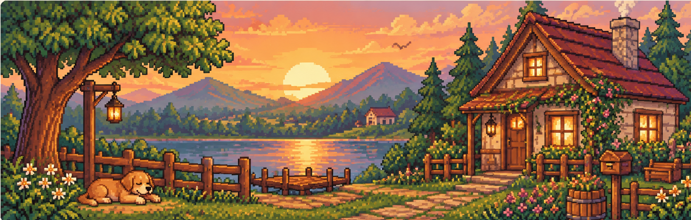
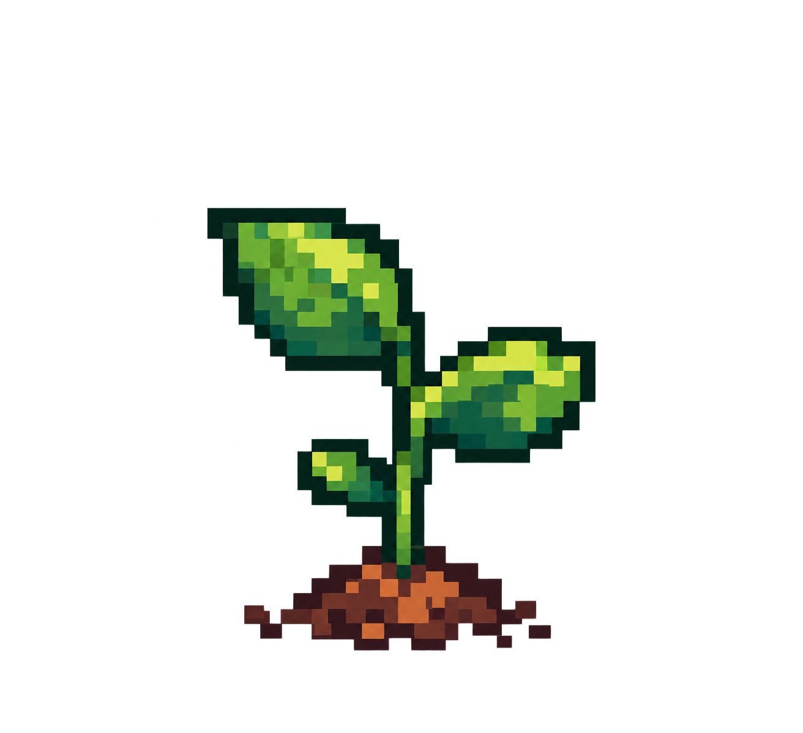
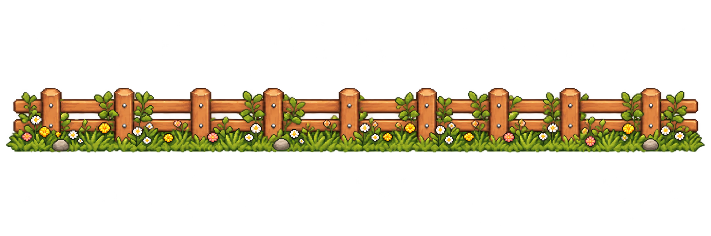

<!-- ========================================= -->
<!--              PROFILE HEADER               -->
<!-- ========================================= -->

  

<!-- ========================================= -->
<!--               MAIN LAYOUT                 -->
<!-- ========================================= -->

<table width="100%">
<tr>
<!-- =============== LEFT COLUMN ============== -->
<td width="65%" valign="top">

<!-- ABOUT ME -->

<h3>🌱 About Me</h3>

  
  I'm a Computer Science student pursuing an Honors specialization in AI &amp; ML.
    
  I enjoy building interactive experiences and exploring the intersection of web development, machine learning, and thoughtful design.

 

  
  
  
  
  
  

<!-- FEATURED PROJECTS -->

<h3>⭐ Featured Projects</h3>

<!--
PROJECT CARD TEMPLATE

<tr>
  <td width="34%">
    
  </td>
  <td width="66%">
    <a href="REPOSITORY_URL"><b>PROJECT NAME ↗</b></a>
     
    Short project description.
      
    TECH 1 · TECH 2 · TECH 3
  </td>
</tr>
-->

  Selected projects will find their place here soon.

<!-- CONTRIBUTION ACTIVITY -->

<h3>📊 Contribution Activity</h3>

  

</td>

<!-- =============== RIGHT COLUMN ============= -->
<td width="35%" valign="top">

<!-- SKILLS -->

<h3>🧰 Skills</h3>

<b>Languages</b>

  
  
  

<b>Frontend</b>

  
  
  

<b>AI &amp; Machine Learning</b>

  
  

<b>Tools</b>

  
  
  

<!-- CURRENTLY LEARNING -->

<h3>📖 Currently Learning</h3>

- Full-stack development
- Frontend architecture
- AI &amp; ML applications
- Backend and data systems

  

<!-- GITHUB STATS -->

<h3>🏆 GitHub Stats</h3>

  

  

</td>
</tr>
</table>

<!-- ========================================= -->
<!--             BOTTOM DECORATION             -->
<!-- ========================================= -->

  

  Thanks for stopping by. Have a lovely day! 🌼

